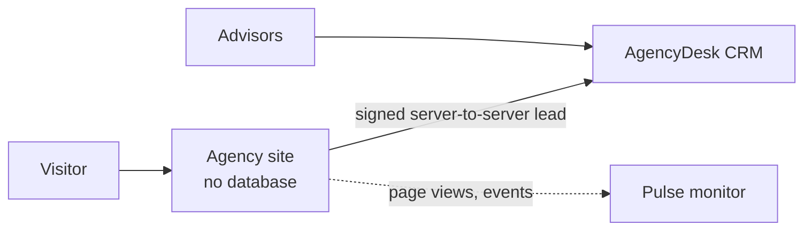

# Agency site knowledge base

The public website of a two-person AI automation agency. It sells services (an automation audit, workflow
automation, AI chat agents and more) and a few digital products, and sends every enquiry to the agency CRM. There is
no checkout on the site.

Pages in this folder:

- this overview;
- [engineering-highlights.md](engineering-highlights.md): the decisions beyond "it works", and where each lives;
- [future-scope.md](future-scope.md): what is planned later and what triggers it.

## Two brands, one codebase

| Brand | Market                   | Tone                                   | Main CTA         |
| ----- | ------------------------ | -------------------------------------- | ---------------- |
| US    | United States            | Direct, outcome first, fixed scope     | Book a free call |
| Asia  | UAE first, then Pakistan | Warmer, founders up front, local proof | Chat on WhatsApp |

The brand comes from the `BRAND` env, one Vercel project per brand.

## Systems

## Content

| Folder                        | Holds                                                                                                              |
| ----------------------------- | ------------------------------------------------------------------------------------------------------------------ |
| `src/content/services/`       | One file per service: what the client gets, our steps, timeline, outcome and prices per region (US, UAE, Pakistan) |
| `src/content/products.ts`     | The five digital products, enquiry only for now                                                                    |
| `src/brands/us.ts`, `asia.ts` | What each brand changes: tone, hero, CTAs, featured order, industries, currency, time zone, spelling and theme     |

`siteContent(brand, region)` in `src/content/resolve.ts` merges the two into what a page shows.
