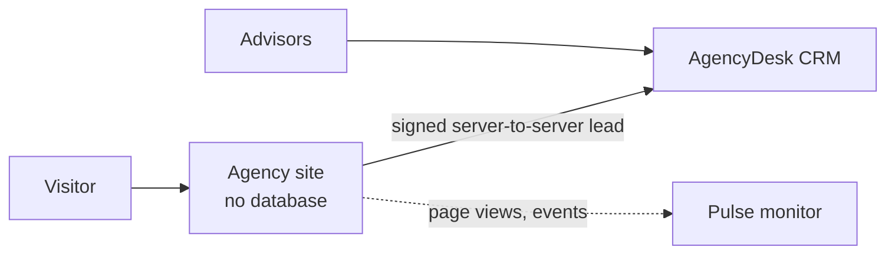

# Agency site knowledge base

The public websites of a two-person agency, from one codebase: DevXonic (a full-service software company) and Radian
Zest (a US digital growth and technology agency). Each brand shows its own eight services and sends every enquiry to
the agency CRM. Prices are quoted after a short call; there is no checkout on the site.

Pages in this folder:

- this overview;
- [engineering-highlights.md](engineering-highlights.md): the decisions beyond "it works", and where each lives;
- [future-scope.md](future-scope.md): what is planned later and what triggers it.

## Two brands, one codebase

| Brand | Market                   | Tone                                   | Main CTA         |
| ----- | ------------------------ | -------------------------------------- | ---------------- |
| US    | United States            | Direct, outcome first, fixed scope     | Book a free call |
| Asia  | UAE first, then Pakistan | Warmer, founders up front, local proof | Chat on WhatsApp |

The brand comes from the `BRAND` env, one Vercel project per brand.

## Systems

## Content

| Folder                        | Holds                                                                                                       |
| ----------------------------- | ----------------------------------------------------------------------------------------------------------- |
| `src/content/services/`       | Each brand's eight services: summary, deliverables and outcome (`devxonic.ts`, `radianzest.ts`)             |
| `src/brands/us.ts`, `asia.ts` | What each brand sets: name, tone, hero, CTAs, regions (label, time zone, industries), spelling and theme    |
| `src/content/company.ts`      | Each brand's Process, Capabilities and FAQ pages; steps, practices and FAQ answers reuse the home page copy |

`siteContent(brand, region)` in `src/content/resolve.ts` merges the two into what a page shows.
